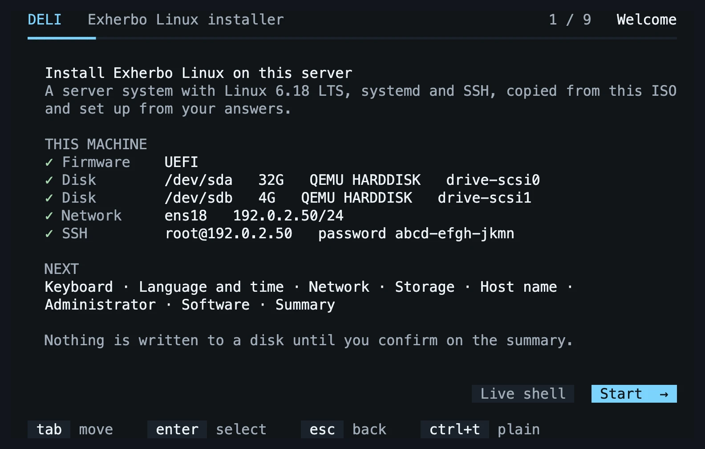
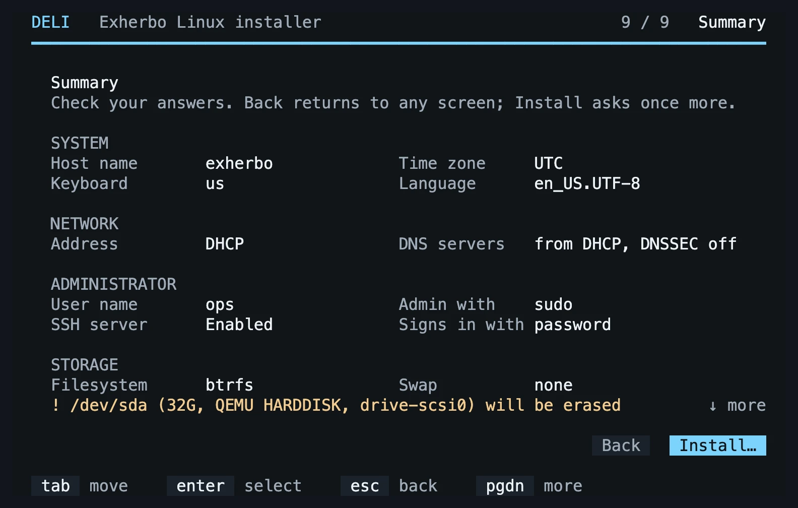

# DELI

**The Davlgd Exherbo Linux Installer: [Exherbo Linux](https://www.exherbo.org) on a server in minutes, not hours.**

[](https://github.com/davlgd/deli/actions/workflows/ci.yml) [](https://github.com/davlgd/deli/releases/latest) [](LICENSE)

Exherbo builds everything from source, so installing it by hand takes hours of compiling. DELI's ISO carries a complete system that is already built, kernel included: it copies it to the disk and configures it from your answers, or from a file. The machine restarts into a ready-to-use server that you reach over SSH.



## Features

- **A guided installer** in the console, on a screen, a server's remote console or a hypervisor; or **over SSH**, from your own terminal.
- **Unattended installations** from a `deli.toml` file, on a second ISO, a USB stick or a web server.
- **Safe by default**: nothing is written to the disk before a summary and a last confirmation; the installer shows the disk it will erase, and an unattended installation with `disk = "auto"` refuses to choose when several could be the one.
- **A lean server system**: Linux 6.18 LTS, systemd, systemd-boot, btrfs with subvolumes (or ext4, xfs), networkd and resolved, SSH, sudo, firmware and early CPU microcode, the QEMU guest agent.
- **Your access, ready on first boot**: a password, SSH keys, or the keys you published on GitHub; sudo with root locked, or, as on Debian, a root password.
- **A cloud image** too, for virtual machines that cloud-init configures on their first boot.
- **Exherbo as usual afterwards**: add repositories and packages during the installation, then `cave resolve -x` builds the rest.

## Quick start

1. **Download** the ISO and its checksum from the [latest release](https://github.com/davlgd/deli/releases/latest), and check it:

   ```sh
   sha256sum -c deli-0.1.0-x86_64.iso.sha256
   ```

2. **Boot it** in UEFI mode, in a virtual machine or from a USB stick (`sudo dd if=deli-0.1.0-x86_64.iso of=/dev/sdX bs=4M status=progress oflag=sync`).
3. **Answer** the questions: keyboard, language and time zone, network, disk, host name, administrator, repositories and packages. DELI checks that the network settings reach the Internet, then shows a summary.

   

4. **Install**, then **reboot** into the new system and log in over SSH.

### On Proxmox VE

Upload the ISO to a storage, then create a VM with these settings:

| Tab | Setting |
| --- | --- |
| OS | the DELI ISO, guest type Linux |
| System | machine q35, BIOS **OVMF (UEFI)**, an EFI disk with **Pre-Enroll keys unchecked** (DELI does not boot with Secure Boot), QEMU agent checked |
| Disks | a SCSI disk of 10 GB or more, controller VirtIO SCSI single |
| CPU, memory | type x86-64-v2-AES (the default) or host, 2 cores or more; 4 GB |
| Network | VirtIO |

In **Options › Boot Order**, put the disk before the CD drive: the empty disk is skipped on the first boot, and once installed, the VM starts from it rather than from the ISO.

## Installing over SSH

The welcome screen shows the installer's address and a password made for this boot. Log in with `ssh root@<address>` and the installer starts in your terminal, where you can paste keys and addresses. A dropped connection never interrupts an installation, and only one runs at a time, from the console or over SSH. The installed system keeps neither that password nor root logins over SSH.

## Installing without questions

Describe the installation in a `deli.toml`. This one is enough:

```toml
[storage]
disk = "auto"   # the only fixed disk; name it when there are several

[admin]
name = "admin"
github = "your-github-user"   # installs the SSH keys published there

[install]
confirm = false   # erase the disk without asking
```

Then give it to the installer:

- **on a volume labelled `CIDATA`**, a second ISO or a USB stick, at its root;
- **or over HTTP**: add `deli.autoinstall=https://example.com/deli.toml` to the kernel command line (press `e` in the boot menu).

DELI checks everything it can before touching the disk, installs and restarts. Every key is documented in [`examples/server.toml`](examples/server.toml): partition layouts, swap, static network, DNSSEC, time zone, keyboard, password hashes, serial console, repositories and packages. Each installed system keeps its own configuration, password hashes removed, in `/var/log/deli/deli.toml`: install one server with the questions, then start from its copy.

If an unattended installation boots the ISO again, DELI sees that the disk already holds this exact installation and leaves it alone; add `deli.reinstall` to the kernel command line to install it again.

## In the live session

- **Alt+F2** opens a root shell while the installer runs; **Ctrl+T** switches the installer to plain text if a console draws it badly.
- `deli install` starts the installer again, or installs from `--config <file>` or a `deli.toml` in the current directory; `--dry-run` prints every action without doing any.
- `deli plan --config deli.toml` shows the partitions a file would create on this machine.
- The second boot entry copies the whole system to memory, so the installation medium can be removed right away.

## Cloud image

Each release also ships `deli-<version>-x86_64-cloud.qcow2`: the same system, without firmware, for virtual machines and clouds. It holds no login, host name, network setting or SSH host key: cloud-init sets them on the first boot, from what the platform gives, and grows the root to fill the disk.

On Proxmox VE, from the host's shell, make a template from it:

```sh
qm create 9000 --name deli --ostype l26 --machine q35 --bios ovmf \
  --efidisk0 local-lvm:1,efitype=4m,pre-enrolled-keys=0 \
  --cpu x86-64-v2-AES --cores 2 --memory 2048 --net0 virtio,bridge=vmbr0 \
  --scsihw virtio-scsi-single --scsi0 local-lvm:0,import-from=/root/deli-<version>-x86_64-cloud.qcow2 \
  --ide2 local-lvm:cloudinit --boot order=scsi0 --serial0 socket --agent enabled=1 \
  --ciuser admin --sshkeys ~/.ssh/authorized_keys --ipconfig0 ip=dhcp --ciupgrade 0
qm disk resize 9000 scsi0 32G
qm template 9000
```

Then clone it as often as needed. `--ciupgrade 0` matters: otherwise Proxmox asks the first boot to upgrade the system, which on Exherbo can mean a long build from source. Devices passed through to the VM may need `firmware/linux-firmware`, which the image leaves out. As with the ISO, the image boots in UEFI mode only, with Secure Boot off.

cloud-init and growpart are not packaged by Exherbo: they come from the [`davlgd` repository](https://github.com/davlgd/exheres), which the image declares and syncs with the others. `cave sync` fetches their new versions with the rest, and `cave resolve -x` installs them like any other package. Should that repository become unreachable, `cave sync` reports it as failed and still syncs the others.

## Requirements and limits

| | |
| --- | --- |
| Machine | 64-bit x86 with x86-64-v2 (SSE4.2, POPCNT), UEFI firmware, Secure Boot off |
| Disk | 10 GB or more, used entirely |
| Memory | 4 GB |
| Not yet | legacy BIOS, LVM, encryption, software RAID, several disks; the guided installer on a serial console (use a configuration file there) |

## After the installation

The kernel lives in `/usr/lib/modules` and its configuration in `/proc/config.gz`. To replace it, build a new one and register it with `kernel-install add <version> <vmlinuz>`: the initramfs and the boot entry are made for you. Repositories and packages work as on any Exherbo system: `cave sync`, then `cave resolve -x <package>` (without `-x`, cave only shows what it would do).

## Building the images

On any x86_64 Linux machine with Docker, allowed to run privileged containers with loop devices for the cloud image:

```sh
iso/build.sh   # writes out/deli-<version>-x86_64.iso and out/deli-<version>-x86_64-cloud.qcow2
```

The first build compiles the whole system from source, which takes from twenty minutes to over an hour depending on the machine; later builds reuse Docker's cache and take a few minutes. [`DESIGN.md`](DESIGN.md) explains how DELI and its images are made and tested, and [`AGENTS.md`](AGENTS.md) how to work on the code.

## License

[Apache License 2.0](LICENSE).
